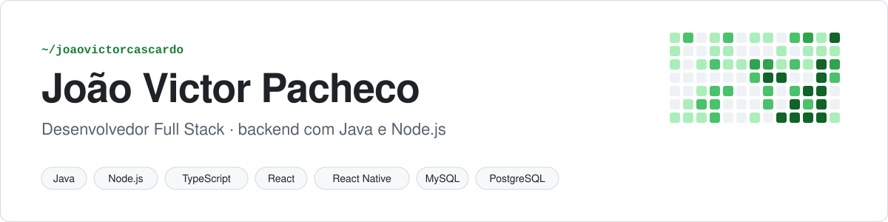
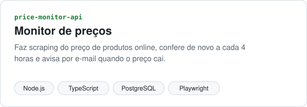
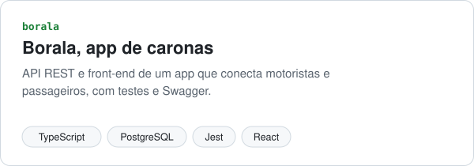
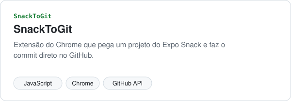
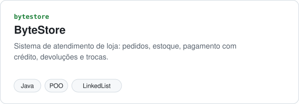
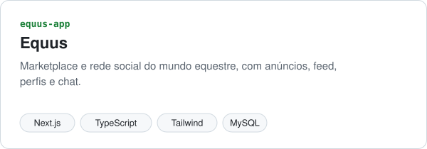
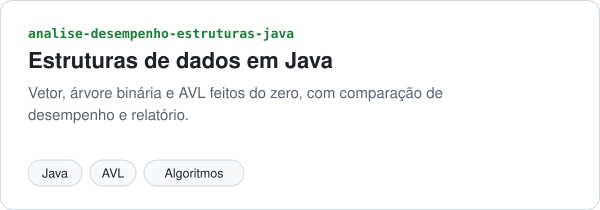

<picture>
  <source media="(prefers-color-scheme: dark)" srcset="./assets/banner-dark.svg">
  
</picture>

Faço Análise e Desenvolvimento de Sistemas na Faminas e sou trainee de Java na Foursys. Gosto de pegar o problema do começo: entender a regra de negócio, modelar o banco, montar a API e depois fazer a tela que consome ela.

## Projetos

<a href="https://github.com/joaovictorcascardo/price-monitor-api"><picture><source media="(prefers-color-scheme: dark)" srcset="./assets/card-price-monitor-api-dark.svg"></picture></a>
<a href="https://github.com/joaovictorcascardo/borala-api"><picture><source media="(prefers-color-scheme: dark)" srcset="./assets/card-borala-dark.svg"></picture></a>

<a href="https://github.com/joaovictorcascardo/SnackToGit"><picture><source media="(prefers-color-scheme: dark)" srcset="./assets/card-SnackToGit-dark.svg"></picture></a>
<a href="https://github.com/joaovictorcascardo/bytestore"><picture><source media="(prefers-color-scheme: dark)" srcset="./assets/card-bytestore-dark.svg"></picture></a>

<a href="https://github.com/joaovictorcascardo/equus-app"><picture><source media="(prefers-color-scheme: dark)" srcset="./assets/card-equus-app-dark.svg"></picture></a>
<a href="https://github.com/joaovictorcascardo/analise-desempenho-estruturas-java"><picture><source media="(prefers-color-scheme: dark)" srcset="./assets/card-analise-desempenho-estruturas-java-dark.svg"></picture></a>

## Tecnologias

  

## Contato

  
  

<picture>
  <source media="(prefers-color-scheme: dark)" srcset="https://raw.githubusercontent.com/joaovictorcascardo/joaovictorcascardo/output/github-contribution-grid-snake-dark.svg">
  
</picture>
