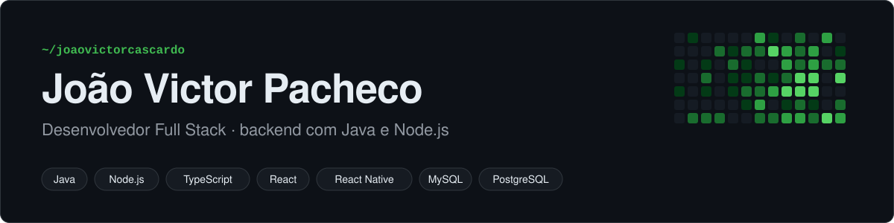
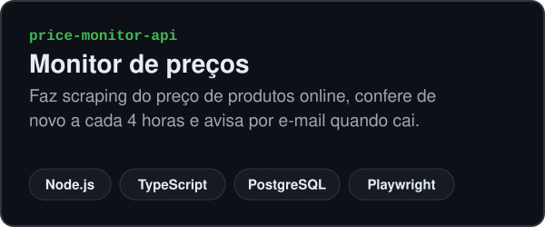
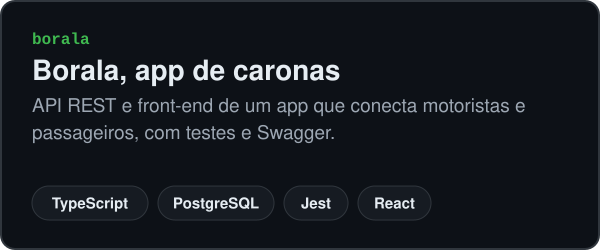
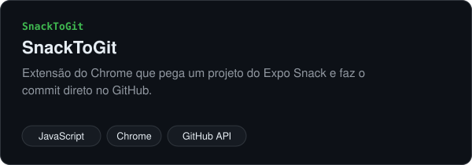
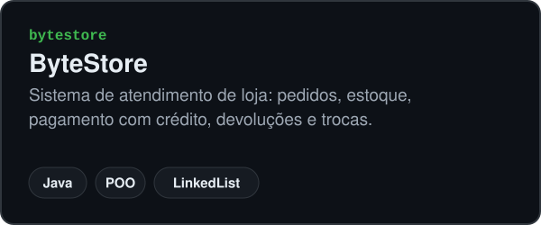
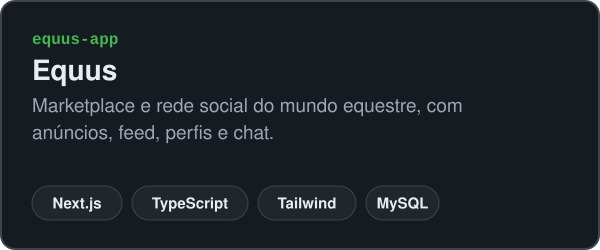
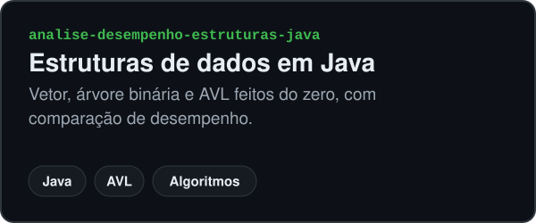

Faço Análise e Desenvolvimento de Sistemas na Faminas e sou trainee de Java na Foursys. Gosto de pegar o problema do começo: entender a regra de negócio, modelar o banco, montar a API e depois fazer a tela que consome ela.

## Tecnologias

  

## Projetos

## Contato

  
  

